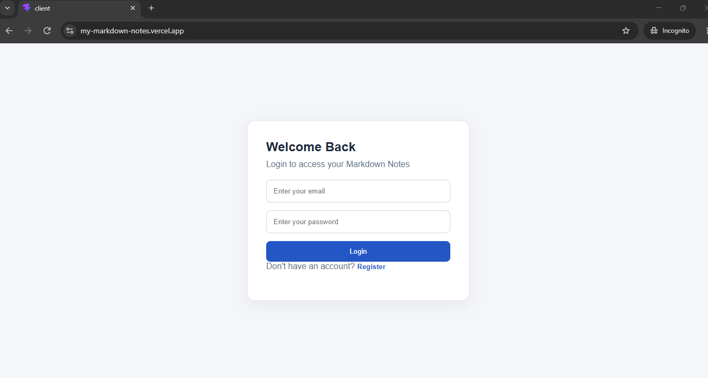
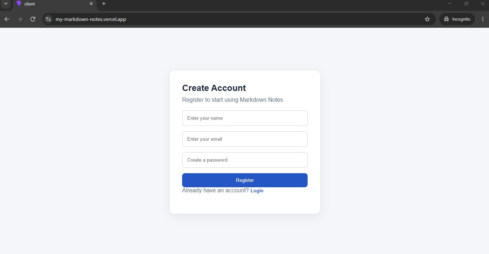
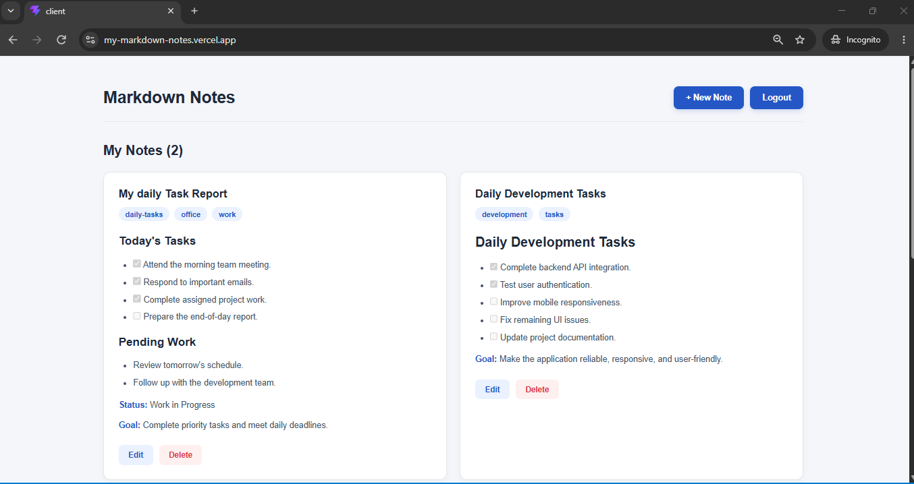

# Markdown Notes App

A simple and practical note-taking application built using the MERN stack.

I built this project to practice full-stack development and understand how the frontend, backend, database, and authentication work together in a real application.

The app allows users to create an account, log in, and manage their personal notes. It also includes a Markdown editor with a live preview, so users can format their notes while writing.

## Live Demo

Try the application here:

**[Markdown Notes App](https://my-markdown-notes.vercel.app/)**

## Screenshots

### Login


### Register


### Notes Dashboard


## What Can You Do With It?

- Create an account and log in securely.
- Create, edit, and delete notes.
- Write notes using Markdown.
- Preview Markdown content while writing.
- Use task lists, tables, and other GitHub Flavored Markdown features.
- Add tags to organize notes.
- Access your own notes after logging in.
- Continue working with saved notes after refreshing the page.

## Technologies I Used

**Frontend**
- React.js
- Vite
- Axios
- React Markdown
- Remark GFM
- CSS

**Backend**
- Node.js
- Express.js
- MongoDB
- Mongoose
- JWT
- bcrypt.js

**Deployment**
- Vercel for the frontend
- Render for the backend
- MongoDB Atlas for the database

## How the Project Is Organized

The project has two main parts:

- `client` – Contains the React frontend.
- `server` – Contains the Express backend, API routes, controllers, models, and authentication logic.

There is also a `screenshots` folder containing images of the application.

## Run the Project Locally

If you want to run this project on your computer, follow these steps.

### 1. Clone the repository

```bash
git clone https://github.com/anukulchoudhary07/Mern-markdown-notes.git

cd Mern-markdown-notes
```

### 2. Set up the backend

```bash
cd server
npm install
```

Create a `.env` file inside the `server` folder:

```env
PORT=5000
MONGO_URI=your_mongodb_connection_string
JWT_SECRET=your_jwt_secret
```

Start the backend:

```bash
npm run dev
```

### 3. Set up the frontend

Open another terminal:

```bash
cd client
npm install
```

Create a `.env` file inside the `client` folder:

```env
VITE_API_URL=http://localhost:5000/api
```

Start the frontend:

```bash
npm run dev
```

Open the local URL provided by Vite in your browser.

## API Endpoints

Here are the main API routes used in the application.

### User Authentication

| Method | Endpoint | Purpose |
|---|---|---|
| POST | `/api/users/register` | Create a new account |
| POST | `/api/users/login` | Log in to an account |

### Notes

| Method | Endpoint | Purpose |
|---|---|---|
| POST | `/api/notes` | Create a note |
| GET | `/api/notes` | Get all your notes |
| GET | `/api/notes/:id` | Get a specific note |
| PUT | `/api/notes/:id` | Update a note |
| DELETE | `/api/notes/:id` | Delete a note |

Note routes are protected and require a valid JWT token.

## What I Learned

While building this project, I got practical experience with:

- Connecting a React frontend to an Express backend.
- Building REST APIs and handling HTTP requests.
- Implementing user registration and login with JWT.
- Hashing passwords using bcrypt.
- Connecting MongoDB Atlas with a Node.js application.
- Using Axios to communicate with backend APIs.
- Managing application state and handling loading and error states.
- Deploying a full-stack application using Vercel and Render.

## Future Improvements

I would like to add a few more features as I continue working on this project:

- Search notes by title or content.
- Pin important notes.
- Add dark mode.
- Improve the Markdown editing experience.
- Allow users to share notes.

## Author

**Anukul Choudhary**

GitHub: [anukulchoudhary07](https://github.com/anukulchoudhary07)

---

Thanks for checking out my project!
